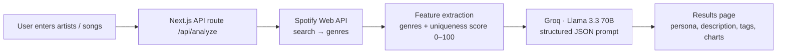

# SoundSnitch 🎧 "Your music taste snitched on."

**Live:** https://sound-snitch.vercel.app

Enter up to 10 artists or songs you love. SoundSnitch pulls their genre data from the Spotify Web API, scores how niche your taste is and has an LLM write a witty "music personality" from that data.

## How it works


## Engineering details
- **Server-side API route** (`src/app/api/analyze/route.js`) keeps the Spotify and Groq keys off the client
- **Prompt engineering for structured output:** the model must return strict JSON (`persona`, `description`, `tags`). The route strips code fences and parses the result, and falls back to a safe default persona if the model returns malformed output.
- **Defensive API handling:** tolerates empty search results and non-JSON responses, and works around Spotify deprecating artist popularity
- **UI:** React 19, Next.js App Router, Tailwind, shadcn/ui, Framer Motion animations, Recharts taste-profile charts

## Tech stack
Next.js 16 · React 19 · JavaScript · Tailwind CSS · shadcn/ui · Recharts · Spotify Web API · Groq SDK (Llama 3.3 70B) · Vercel

## Run locally
```bash
npm install
# .env.local
SPOTIFY_CLIENT_ID=...
SPOTIFY_CLIENT_SECRET=...
GROQ_API_KEY=...
npm run dev   # http://localhost:3000
```

## What I'd add next
Response caching for repeat artists, rate limiting on the API route, and a shareable results card.
